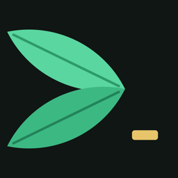
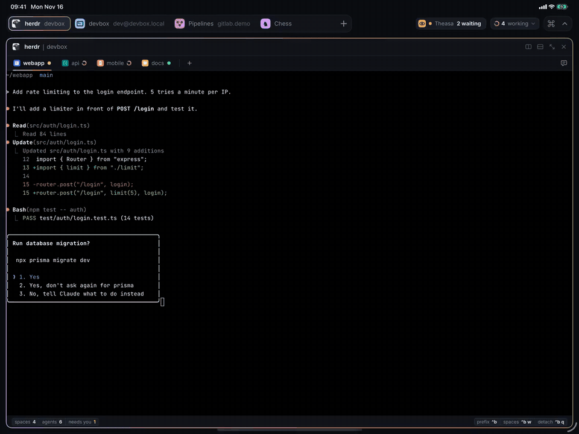

<p align="center">
  
</p>

<h1 align="center">Sidra</h1>

<p align="center">
  Your coding agents in herdr, on your iPad and iPhone.<br>
  <a href="https://apps.apple.com/app/id6832359499">App Store</a> ·
  <a href="https://kunba-labs.github.io/sidra/">Website</a> ·
  <a href="docs/herdr.md">Patch herdr</a> ·
  <a href="https://github.com/Kunba-Labs/theasa">Theasa</a>
</p>

<p align="center">
  
</p>

Sidra is a native app for iPad and iPhone. You run your coding agents (Claude Code, Codex and
others) in [herdr](https://herdr.dev) on a Mac or a Linux machine. Sidra connects over SSH and opens
herdr in a tab. herdr's spaces and their tabs show as chips, with a dot for each agent that needs you.

Every tab is a card in one workspace. Split a card, make it full screen, or close it.

## Get started

You need a Mac or a Linux machine with SSH turned on, and Sidra on an iPad or iPhone with iOS 26 or later.

1. Install Sidra from the [App Store](https://apps.apple.com/app/id6832359499).
2. Tap **+** and choose **SSH host**. Enter an alias, the host name, the port and your user name.
3. Tap **Copy public key** under the key, and add it to `~/.ssh/authorized_keys` for that user on the machine.
4. Tap **Test connection**, then **Save**. A terminal on the machine opens.
5. Tap **+** and choose **herdr**. Pick the machine to see its herdr spaces.
   If herdr is not installed, tap **Install herdr**.
6. Tap **Open spaces**. Use **New space** for a project folder, then **Start coding agent** in it.

## Optional setup

### Reach your machine from anywhere

Use [Tailscale](https://tailscale.com). Install it on the machine and on your iPad or iPhone, and add
the machine in Sidra by its Tailscale name (for example `devbox.your-tailnet.ts.net`). You do not
open a port to the internet, and the connection works at home and away.

### Hide herdr's tab row

Sidra shows herdr's tabs as chips, so herdr's own tab row shows them twice in a space with several
tabs. A one-line patch to the herdr client hides that row. Point your coding agent at
[docs/herdr.md](docs/herdr.md) on the machine that runs herdr, or follow the steps yourself.

### Add Theasa

[Theasa](https://github.com/Kunba-Labs/theasa) is a small server that records your Claude Code and
Codex turns and writes a summary of each. Run it on the same machine as herdr, then tap the Theasa
pill in Sidra's title bar and enter its address and token. Its README has the setup, with Tailscale.

## Features

| Tab | What you get |
| --- | --- |
| **herdr** | herdr's own client in a terminal. Spaces and agents show as chips, with a dot for each agent that needs you. |
| **SSH host** | A terminal on any machine you reach over SSH, with mosh for hosts that have it. |
| **Theasa** | A summary of every Claude Code and Codex turn, from a [Theasa](https://github.com/Kunba-Labs/theasa) server you run. Answer waiting agents from the title bar. |
| **Pipelines** | The GitLab pipelines of your projects, with the log of each failed job. |
| **HackerTab** | Hacker News, comments first. |
| **Chess** | A game against Sidra's own engine, on your device. |

The terminal is [libghostty-vt](https://ghostty.org) with Sidra's own renderer. SSH keys stay in the
Keychain, and keys made in the Secure Enclave never leave it.

## Build from source

You need a Mac with Xcode 27 and [XcodeGen](https://github.com/yonaskolb/XcodeGen).

1. Clone the repository:

   ```sh
   git clone https://github.com/Kunba-Labs/sidra.git
   cd sidra
   ```

2. To run on a device, set your own `DEVELOPMENT_TEAM` and `PRODUCT_BUNDLE_IDENTIFIER` in `project.yml`.
3. Generate the project and open it. Run `xcodegen generate` again after each change to `project.yml`.

   ```sh
   xcodegen generate
   open Sidra.xcodeproj
   ```

4. Run the `Sidra` scheme on an iPad or iPhone simulator.

For made-up data in the herdr, SSH, Theasa and Pipelines tabs, add the launch argument `-sidra.demo`.
It works in Debug builds on the simulator, and it reads test data from this checkout.

### Tests

```sh
xcodebuild test -project Sidra.xcodeproj -scheme Sidra \
  -destination 'platform=iOS Simulator,name=iPad Pro 13-inch (M5)' \
  -skipPackagePluginValidation -skip-testing:SidraUITests
```

Use any simulator from `xcrun simctl list devices available` as the destination. Tests that need an SSH server read `SIDRA_TEST_SSH=user:password@host:port` and skip when it does
not answer. `tools/store-shots.sh` makes the App Store screenshots from the demo mode.

### Layout

| Folder | Contents |
| --- | --- |
| `Sidra/` | The app: workspace, tabs, herdr, Theasa, Pipelines, settings |
| `Packages/SidraDesign` | Colours, type, cards, pill tabs, icons |
| `Packages/SidraWorkspace` | Tabs, the pane tree, layout and persistence |
| `Packages/SidraTerminal` | libghostty-vt, the renderer, the SwiftTerm fallback, mosh |
| `Packages/SidraSSH` | SSH, keys, known hosts, mosh settings |
| `Packages/SidraTheasa` | The Theasa client |
| `Packages/SidraHackerTab`, `Packages/SidraChess` | HackerTab and Chess |
| `tools/` | Release, screenshots and the herdr patch |

## Privacy

Sidra has no account, no analytics and no tracking. It connects to the machines and servers you add.
HackerTab also loads Hacker News (its Firebase API and Algolia search) and the icons of linked sites.
Passwords, tokens and keys are in the Keychain of your device.

## License

Apache License 2.0. Copyright 2026 Kunba Labs BV. See [LICENSE](LICENSE).

herdr, libghostty-vt, SwiftTerm and Citadel keep their own licenses.
